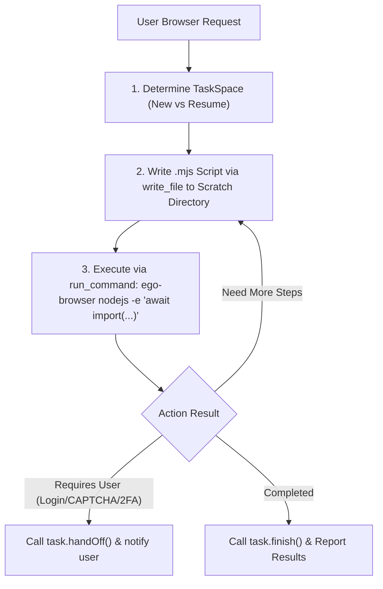

# Ego Browser Automation Skill for Antigravity

Ego Browser (Ego Lite) allows the agent to control a live Chromium browser instance with access to the user's logged-in cookies and sessions.

> [!NOTE]
> Unlike legacy agent environments (such as Codex), **do not run `ego-browser skill` in the terminal**. This skill is already tailored for Antigravity's progressive disclosure, Windows PowerShell shell, and artifact storage architecture.

---

## Antigravity-Native Execution Workflow



### 1. Step 1: Write Automation Script via `write_file`
Always write your automation logic to a `.mjs` file in the Antigravity conversation scratch directory:
- **Scratch Path**: `<appDataDir>\brain\<conversation-id>/scratch/ego/round-01.mjs`
- Using `write_file` ensures pure UTF-8 encoding and prevents PowerShell 5.1 quote-stripping or argument-splitting issues.

#### Minimal Round-01 Starter Template:
```javascript
// round-01.mjs
// SPACE_ID is null for a new goal; use the numeric ID (e.g. 12) to continue an existing session
const SPACE_ID = null;

let task;
if (SPACE_ID === null) {
  task = await taskSpace("browser-task-goal");
} else {
  const spaces = await listTaskSpaces();
  const entry = spaces.find((s) => s.id === SPACE_ID);
  if (!entry) {
    task = await taskSpace("browser-task-goal");
  } else if (entry.ownership === "user") {
    task = await claimTaskSpace(SPACE_ID);
  } else if (entry.ownership === "agentDelegatedToUser") {
    task = await takeOverTaskSpace(SPACE_ID);
  } else {
    task = await taskSpace(SPACE_ID);
  }
}

// Get the main page (p1)
const pages = await task.pages();
const page = pages.length > 0 ? pages[0] : (await task.adopt((await task.tabs())[0].page));

console.log({ taskSpaceId: task.spaceId, pageLabel: page.label });

// Navigate to target
await page.goto("https://example.com");
await page.waitForLoadState("load");

// Capture and print snapshot for the next round
console.log(await page.snapshot());
```

### 2. Step 2: Execute the Script via `run_command`
Run the one-line ESM dynamic import in PowerShell:

```powershell
ego-browser nodejs -e "await import('file:///C:/Users/Administrator/.gemini/antigravity/brain/<conversation-id>/scratch/ego/round-01.mjs')"
```

> [!IMPORTANT]
> - Always use forward slashes (`/`) in the `file:///` URI path.
> - Each run starts a fresh Node.js process. In-memory JS variables reset, but open browser tabs and TaskSpaces persist. Record the `taskSpaceId` from output for subsequent rounds.

### 3. Step 3: Observe and Act (Semantic First)
1. **Semantic Snapshot**: Use `console.log(await page.snapshot())`. Elements appear with references such as `@12` or accessible role locators `loc=role:button[name='Sign in']`.
2. **Perform Actions**:
   ```javascript
   await page.fill("@12", "search query");
   await page.click("@15", { label: "Click search button" });
   ```
3. **Data Extraction**: For bulk extraction, use `page.evaluate()` to serialize data directly:
   ```javascript
   const data = await page.evaluate(() => [...document.querySelectorAll("h3")].map(el => el.textContent));
   console.log(data);
   ```
4. **Visual Inspection**: If DOM semantics are unavailable (e.g. canvas, maps), capture a screenshot to scratch:
   ```javascript
   await page.screenshot({ path: "C:/Users/Administrator/.gemini/antigravity/brain/<conversation-id>/scratch/ego/view.png" });
   ```
   Inspect the image using the `read_file` tool.

---

## Safety, Handoff & Completion Rules

### Human Verification & Login Handoff
- If a CAPTCHA, Cloudflare Turnstile, 2FA prompt, or credential-less login wall appears:
  1. Call `await task.handOff();`
  2. Inform the user in chat to complete verification in their Ego Lite browser window.
  3. **Never** attempt to solve, click through, or bypass CAPTCHAs.
  4. Once the user replies, resume control with `const task = await takeOverTaskSpace(SPACE_ID);`.

### Task Completion (`task.finish()`)
- When the goal is met, run a final teardown round:
  ```javascript
  const task = await taskSpace(SPACE_ID);
  // Default: close all tabs created during the session
  await task.finish({ keep: [] });
  // Or keep a specific result tab if requested by the user:
  // await task.finish({ keep: ["p1"] });
  ```

---

## Detailed References

For advanced operations, consult the detailed documentation:

- **[Full API Reference](references/api.md)**: Signatures for `taskSpace`, `Page`, locators, mouse, keyboard, downloads, dialogs, and CDP.
- **[Windows & PowerShell Guide](references/windows.md)**: Shell encoding, argument rules, path conventions, and troubleshooting.
- **[Automation Patterns](references/patterns.md)**: Ready-to-use ESM templates for form filling, login handoff, data extraction, and file transfers.
- **[Selector & DOM Guide](references/selectors.md)**: Detailed locator syntax (`@ref`, `loc=role:`, `text=`, `loc=css:`, iframe subtrees).
- **[Clearing Cookies & State](references/clearing-state.md)**: Safe vs profile-wide cache clearing rules.
- **[Installation & Upgrade](references/install.md)**: Setup and version upgrade procedures.
- **[Antigravity Subagent Guide](agents/subagent-guide.md)**: Delegating browser tasks to an autonomous subagent.
